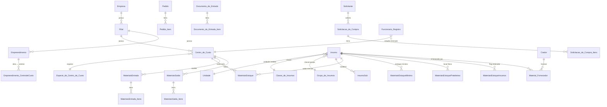

# Schema do Informakon (SQL Server — `dbTREINO_CV`)

> Extraído em 27/10/2026 de `CGSRV2023 / 172.16.1.123 : dbTREINO_CV` (banco de treino,
> mesmo schema do `dbCONV` de produção que a QWeb lê). Somente leitura.
> O banco tem **2.004 tabelas**; este documento cobre as ~35 relevantes ao
> domínio de suprimentos/almoxarifado que o CGStok consome.

## 1. Visão geral do modelo

Conceitos centrais do Informakon (legado Delphi, convenções próprias):

- **Empresa + Filial + Centro de Custo** formam a chave organizacional de quase tudo.
  `Empresa_Cod char(3)` = SPE (ex.: `CVP`, `CJG`, `PSC`, `CVC`, `CVJ`, `TST`),
  `Filial_Cod char(2)`, `Centro_Cod char(4)`.
- **Centro de Custo ≠ só contábil**: é também a **localização física do estoque**.
  `EspCentro_Cod` (espécie) classifica: `OP`=Obra Própria, `OC`=Obra Contratada,
  `DM`=**Almoxarifado Central**, `ES`=Escritório, `OF`=Operações Financeiras,
  `PJ`=Projeto, `AD`=Obra por Administração, `LO`=Loteamento, `MN`=Manutenção, `DR`=Diretoria.
  No treino, o estoque real está nos centros `OP` (uma obra = um estoque).
- **Chave composta serializada**: `Empresa.Filial.Centro`/`EImo` concatenados —
  ex.: `KeyEmpreendimento = 'CVP.01.0001'`, `Centro_CodC = 'CVP010008'`.
- **Insumo** = produto/material/serviço. `InsumoSub` = subitem (variante) — `SubInsumo_Cod=0`
  significa "sem subitem". Classificação em 2 níveis: `Classe_de_Insumos` > `Grupo_de_Insumos`.
- **Credor** = fornecedor/credor genérico (pessoa jurídica ou física).
- **Solicitante** = pessoa que solicita materiais (cadastro simples de requisitantes).
- Estoque: **snapshot mensal** em `MateriaisEstoque` (chave inclui `Estoque_AnoMes`
  `YYYYMM`). Movimentos em `MateriaisEntrada[_Itens]` / `MateriaisSaida[_Itens]`.
- Compras: `Solicitacao_de_Compra[_Itens]` → `Pedido[_Item]` → `Documento_de_Entrada[_Item]` (NF de entrada).
- Quase nenhuma FK declarativa no banco (integridade é na aplicação). Poucas PKs
  fora das tabelas principais.

## 2. Diagrama ER (recorte de suprimentos)

## 3. Estratégia de detecção de alterações (p/ sync incremental)

| Tabela | Chave estável | Coluna de mudança | Estratégia |
|---|---|---|---|
| `Insumo` | `Insumo_Cod` (int) | `Audit_LastChange`, `Audit_Insert_Date`, `DATEALT` | incremental por `Audit_LastChange` |
| `InsumoSub` | `(Insumo_Cod, SubInsumo_Cod)` | **nenhuma** | reload completo + hash (22k linhas, leve) |
| `Classe_de_Insumos` | `ClaIns_Cod` | `Audit_LastChange` | incremental |
| `Grupo_de_Insumos` | `(ClaIns_Cod, GruIns_Cod)` | `Audit_LastChange` | incremental |
| `Unidade` | `Unid_Cod` | **nenhuma** | reload completo (84 linhas) |
| `Credor` | `Cre_Cod` | `Audit_LastChange`, `Audit_Insert_Date` | incremental |
| `Solicitante` | `Solicitante_Cod` | **nenhuma** | reload completo |
| `Empresa`/`Filial` | `Empresa_Cod`/`+Filial_Cod` | `Audit_LastChange` | incremental |
| `Centro_de_Custo` | `(Empresa,Filial,Centro)` | `Audit_LastChange`, `Data_Modificacao` | incremental |
| `Empreendimento` | `(Empresa,Filial,EImo_Numero)` | `Audit_LastChange` | incremental |
| `Cadastro_de_Obras` | `Obra_Numero` | `Audit_LastChange` | incremental |
| `MateriaisEstoque` | `(Emp,Fil,Centro,AnoMes,Insumo,Sub)` | `Estoque_AnoMes` (snapshot) | ler só `AnoMes` corrente/último por centro; upsert por chave |
| `MateriaisEstoqueMinimo` | `(Emp,Fil,Centro,Insumo,Sub)` | **nenhuma** | reload completo (pequena) |
| `MateriaisEstoquePrateleiras` | `(Emp,Fil,Centro,Insumo,Sub)` | **nenhuma** | reload completo (vazia no treino) |
| `MateriaisEntrada[_Itens]` | `Entrada_Numero`/`+Item` | `Audit_Insert_Date`, `Audit_LastChange` | incremental |
| `MateriaisSaida[_Itens]` | `Saida_Numero`/`+Item` | `Audit_Insert_Date`, `Audit_LastChange` | incremental |
| `Pedido[_Item]` | `Pedido_Numero`/`+Item` | `Audit_LastChange` (cabeçalho) | incremental |
| `Solicitacao_de_Compra[_Itens]` | `Solic_Numero`/`+Item` | `Audit_LastChange` (cabeçalho) | incremental |
| `Documento_de_Entrada[_Item]` | `Ent_Numero`/`+Item` | `Audit_Insert/LastChange` + `Audit_Cancel*` | incremental |
| `Funcionario_Registro` | `(Emp,Fil,Centro,AnoMes,RE_Numero)` | `Data_Modificacao` | **registro mensal** — ver nota ⚠️ |

⚠️ **Funcionários**: `PFUNC` (RH/RM) e `Usuarios` estão vazias no treino;
`Funcionario_Registro` é registro mensal de ponto (2 linhas em 2026-10).
A fonte real do cadastro de funcionários do CGStok hoje é o XLSX importado.
**[INFERIDO]** — confirmar em produção qual tabela alimenta o cadastro de funcionários
(candidatas: `Funcionario_Registro` último `AnoMes`, `PFUNC`, `Solicitante`).

⚠️ **Exclusões**: sem `rowversion` útil (só 1 tabela tem) e sem soft-delete padronizado
(`Centro_de_Custo_Excluido`, `Insumo_OLD`, `Funcionario_Registro_Excluido` existem como
tabelas de arquivo morto — itens "excluídos" podem ser movidos para elas ou marcados
`*_Obsoleto`/`Inativo`). A sync deve tratar ausência na origem como desativação,
não delete — ver `mapeamento.md`.

## 4. Tabelas (detalhe)

Convenção: `⏱ sync` = coluna útil para detecção de mudança. Tipos `char`/`nchar`
vêm **com espaços à direita** (padding) — sempre `RTRIM` ao ler.
### `Empresa` — 6 linhas (treino)

PK: `Empresa_Cod`

| Coluna | Tipo | Nulo | Obs |
|---|---|---|---|
| `Empresa_Cod` | char(3) | não | PK |
| `Empresa_Nome` | char(100) | não |  |
| `Empresa_CtbMesAnoIni` | char(6) | sim |  |
| `Empresa_ExercicioCTB` | char(4) | sim |  |
| `Empresa_Ordem` | char(1) | sim |  |
| `Cre_Cod` | char(6) | sim |  |
| `Empresa_Logomarca` | image | sim |  |
| `Empresa_Logomarca_Classname` | char(80) | sim |  |
| `Conta_Resultado` | char(12) | sim |  |
| `Conta_Lucro` | char(12) | sim |  |
| `ContaCliente_Incorporacao` | char(12) | sim |  |
| `ContaCliente_Adiantamento` | char(12) | sim |  |
| `ContaCliente_Financiamento` | char(12) | sim |  |
| `CTB_DataLimite` | datetime | sim |  |
| `CTB_DataLimite_DocEnt` | datetime | sim |  |
| `Conta_Fornecedor` | char(12) | sim |  |
| `CTB_DataLimite_NFS` | datetime | sim |  |
| `EMPRESA_OBS` | varchar(200) | sim |  |
| `EMPRESA_CODANUENIO` | varchar(4) | sim |  |
| `EMPRESA_CODTRIENIO` | varchar(4) | sim |  |
| `EMPRESA_CODQUIQUEN` | varchar(4) | sim |  |
| `EMPRESA_BASECALC` | float | sim |  |
| `EMPRESA_VINCANUENI` | varchar(100) | sim |  |
| `EMPRESA_VINCTRIENI` | varchar(100) | sim |  |
| `EMPRESA_VINCQUIQUE` | varchar(100) | sim |  |
| `EMPRESA_PERCEXTRA1` | float | sim |  |
| `EMPRESA_PERCEXTRA2` | float | sim |  |
| `EMPRESA_VTRANSP_PERC_SAUSE` | float | sim |  |
| `EMPRESA_VTRANSP_PERC_CAUSE` | float | sim |  |
| `EMPRESA_FPAS` | varchar(3) | sim |  |
| `EMPRESA_ALIQ_RAT` | float | sim |  |
| `EMPRESA_ALIQ_FAP` | float | sim |  |
| `EMPRESA_COD_OUTLOCAL` | varchar(4) | sim |  |
| `EMPRESA_ALIQ_OUTLOCAL` | float | sim |  |
| `EMPRESA_CODGPS` | varchar(4) | sim |  |
| `EMPRESA_ATIVECONOM` | varchar(5) | sim |  |
| `EMPRESA_PERCGFIP` | float | sim |  |
| `EMPRESA_PRINCIPAL` | varchar(1) | sim |  |
| `Conta_PatrimonioLiquido` | char(12) | sim |  |
| `CTBCONFIG_CENTRO` | varchar(1) | sim |  |
| `CTB_DataLimite_FOL` | datetime | sim |  |
| `Empresa_LogoPrincipal` | bit | sim |  |
| `Conta_Provisao_IRPJ` | char(12) | sim |  |
| `Conta_Provisao_CSLL` | char(12) | sim |  |
| `Conta_RLA_IRPJ_CSLL` | char(12) | sim |  |
| `empresaLogomarca` | image | sim |  |
| `CTB_DataLimite_MAT` | datetime | sim |  |
| `CTB_LanCtb_EncerramentoCentro` | char(1) | sim |  |
| `Conta_Prejuizo` | char(12) | sim |  |
| `POC_GER_ContaEmpresa` | char(12) | sim |  |
| `POC_GER_ContaFornecedores` | char(12) | sim |  |
| `Conta_Lucro_Acum` | char(12) | sim |  |
| `Conta_Prejuizo_Acum` | char(12) | sim |  |
| `Empresa_Tipo` | char(1) | sim |  |
| `Audit_UserName` | char(30) | sim | ⏱ sync |
| `Audit_LastChange` | datetime | sim | ⏱ sync |
| `Empresa_CtbPadrao` | char(6) | sim |  |

### `Filial` — 7 linhas (treino)

PK: `Empresa_Cod`, `Filial_Cod`

| Coluna | Tipo | Nulo | Obs |
|---|---|---|---|
| `Empresa_Cod` | char(3) | não | PK |
| `Filial_Cod` | char(2) | não | PK |
| `Filial_Nome` | char(100) | sim |  |
| `Filial_CGC` | char(14) | não |  |
| `Filial_InscricaoEstadual` | char(18) | sim |  |
| `Filial_InscricaoMunicipal` | char(18) | sim |  |
| `Filial_Endereco` | char(40) | não |  |
| `Filial_Numero` | char(6) | sim |  |
| `Filial_Complto` | char(20) | sim |  |
| `Filial_CEP` | char(8) | não |  |
| `Filial_Bairro` | char(30) | sim |  |
| `Filial_Cidade` | char(30) | não |  |
| `Pais_Cod` | char(3) | não |  |
| `UF_Sigla` | char(2) | não |  |
| `Filial_Praca` | char(2) | sim |  |
| `Cre_Cod` | char(6) | sim |  |
| `Municipio_Cod` | char(3) | sim |  |
| `Filial_JuntaComercialNumero` | char(18) | sim |  |
| `Filial_JuntaComercialData` | datetime | sim |  |
| `FILIAL_FPAS` | varchar(3) | sim |  |
| `FILIAL_ALIQ_RAT` | float | sim |  |
| `FILIAL_ALIQ_FAP` | float | sim |  |
| `FILIAL_COD_OUTLOCAL` | varchar(4) | sim |  |
| `FILIAL_ALIQ_OUTLOCAL` | float | sim |  |
| `FILIAL_CODGPS` | varchar(4) | sim |  |
| `FILIAL_PERCGFIP` | float | sim |  |
| `FILIAL_VTRANSP_PERC_SAUSE` | float | sim |  |
| `FILIAL_VTRANSP_PERC_CAUSE` | float | sim |  |
| `RESP_CAGED` | varchar(1) | sim |  |
| `FILIAL_CODGEFIP` | varchar(3) | sim |  |
| … | | | *(+97 colunas fiscais/financeiras omitidas)* |

### `Centro_de_Custo` — 61 linhas (treino)

PK: `Empresa_Cod`, `Filial_Cod`, `Centro_Cod`

| Coluna | Tipo | Nulo | Obs |
|---|---|---|---|
| `Empresa_Cod` | char(3) | não | PK |
| `Filial_Cod` | char(2) | não | PK |
| `Centro_Cod` | char(4) | não | PK |
| `Nucleo_Cod` | char(2) | não |  |
| `Centro_Nome` | char(100) | não |  |
| `EspCentro_Cod` | char(2) | não |  |
| `Centro_Endereco` | char(40) | não |  |
| `Centro_Numero` | char(6) | sim |  |
| `Centro_Complto` | char(20) | sim |  |
| `Centro_CEP` | char(8) | não |  |
| `Centro_Bairro` | char(30) | sim |  |
| `Centro_Cidade` | char(40) | não |  |
| `Pais_Cod` | char(3) | não |  |
| `UF_Sigla` | char(2) | não |  |
| `Centro_EnderecoFaturamento` | char(1) | não |  |
| `Centro_FilialEnderecoFaturamen` | char(2) | sim |  |
| `Centro_EnderecoCobranca` | char(1) | não |  |
| `Centro_FilialEnderecoCobranca` | char(2) | sim |  |
| `Centro_DataEncerramento` | datetime | sim |  |
| `Centro_DataAbertura` | datetime | sim |  |
| `Centro_EstoqueMesAnoInicial` | char(6) | sim |  |
| `Municipio_Cod` | char(3) | sim |  |
| `Centro_RefCod` | char(4) | sim |  |
| `Centro_InscricaoEstadual` | char(18) | sim |  |
| `Centro_TitulosaPagar` | char(1) | sim |  |
| `Centro_Endereco2` | char(40) | sim |  |
| `Centro_Numero2` | char(6) | sim |  |
| `Centro_Complto2` | char(20) | sim |  |
| `Centro_CEP2` | char(8) | sim |  |
| `Centro_Bairro2` | char(30) | sim |  |
| `Centro_Cidade2` | char(40) | sim |  |
| `Pais_Cod2` | char(3) | sim |  |
| `UF_Sigla2` | char(2) | sim |  |
| `Municipio_Cod2` | char(3) | sim |  |
| `Filial_Endereco2` | char(40) | sim |  |
| `Filial_Numero2` | char(6) | sim |  |
| `Filial_Complto2` | char(20) | sim |  |
| `Filial_CEP2` | char(8) | sim |  |
| `Filial_Bairro2` | char(30) | sim |  |
| `Filial_Cidade2` | char(40) | sim |  |
| `Filial_Pais_Cod2` | char(3) | sim |  |
| `Filial_UF_Sigla2` | char(2) | sim |  |
| `Filial_Municipio_Cod2` | char(3) | sim |  |
| `Filial_InscricaoMunicipal2` | char(18) | sim |  |
| `Centro_Folha` | char(60) | sim |  |
| … | | | *(+161 colunas fiscais/financeiras omitidas)* |

### Especie_de_Centro_de_Custo

*(tabela não selecionada p/ extração ou inexistente)*

### `Empreendimento` — 4 linhas (treino)

PK: `Empresa_Cod`, `Filial_Cod`, `EImo_Numero`

| Coluna | Tipo | Nulo | Obs |
|---|---|---|---|
| `Empresa_Cod` | char(3) | não | PK |
| `Filial_Cod` | char(2) | não | PK |
| `EImo_Numero` | int | não | PK |
| `Centro_Cod` | char(4) | sim |  |
| `EImo_NumeroFases` | int | sim |  |
| `EImo_Nome` | char(40) | não |  |
| `EImo_Especie` | char(2) | sim |  |
| `EImo_TerrenoProprietarioAnt` | char(40) | sim |  |
| `EImo_TerrenoAreaTotal` | numeric(12,2) | sim |  |
| `EImo_TerrenoPrecoAquisicao` | numeric(12,2) | sim |  |
| `Elmo_TerrenoPrecoM2` | numeric(12,2) | sim |  |
| `EImo_TerrenoValorRecurso` | numeric(12,2) | sim |  |
| `EImo_TerrenoValorPermuta` | numeric(12,2) | sim |  |
| `EImo_TerrenoEscrituraMatricNum` | char(18) | sim |  |
| `EImo_TerrenoEscrituraLivroNum` | char(10) | sim |  |
| `EImo_RegImovelCartorio` | char(40) | sim |  |
| `EImo_RegIncorporacaoNumero` | char(18) | sim |  |
| `EImo_RegIncorporacaoCartorio` | char(18) | sim |  |
| `EImo_RegIncorporacaoData` | datetime | sim |  |
| `EImo_AlvaraConstrucaoNumero` | char(18) | sim |  |
| `EImo_AlvaraPrefeitura` | char(50) | sim |  |
| `EImo_AlvaraConstrucaoData` | datetime | sim |  |
| `EImo_AreaConstruidaTotal` | numeric(10,2) | sim |  |
| `EImo_CustoConstrucaOrcadoValor` | numeric(12,2) | sim |  |
| `EImo_CustoConstrucaoOrcadoM2` | numeric(10,2) | sim |  |
| `EImo_CustoConstrucaoOrcadoData` | datetime | sim |  |
| `EImo_CustoConstrucaoRealValor` | numeric(12,2) | sim |  |
| `EImo_CustoConstrucaoRealM2` | numeric(10,2) | sim |  |
| `EImo_CustoConstrucaoRealData` | datetime | sim |  |
| `EImo_TerrenoEscrituraFolhaNum` | char(4) | sim |  |
| `EImo_TerrenoEscrituraCartorio` | char(40) | sim |  |
| `EImo_RegImovelNumero` | char(18) | sim |  |
| `EImo_RegImovelData` | datetime | sim |  |
| `EImo_TerrenoDataAquisicao` | datetime | sim |  |
| `EImo_Endereco` | char(40) | sim |  |
| `EImo_EndNumero` | char(6) | sim |  |
| `EImo_Complto` | char(20) | sim |  |
| `EImo_CEP` | char(8) | sim |  |
| `EImo_Bairro` | char(30) | sim |  |
| `EImo_Cidade` | char(30) | sim |  |
| `Pais_Cod` | char(3) | sim |  |
| `UF_Sigla` | char(2) | sim |  |
| `CODEMPREE` | char(4) | sim |  |
| `Bairro_Cod` | char(2) | sim |  |
| `ESQUEMA_ORIGEM` | char(30) | sim |  |
| … | | | *(+84 colunas fiscais/financeiras omitidas)* |

### `Empreendimento_CentrodeCusto` — 23 linhas (treino)

PK: `Empresa_Cod`, `Filial_Cod`, `Eimo_Numero`, `Centro_CodC`

| Coluna | Tipo | Nulo | Obs |
|---|---|---|---|
| `Empresa_Cod` | char(3) | não | PK |
| `Filial_Cod` | char(2) | não | PK |
| `Eimo_Numero` | int | não | PK |
| `Centro_CodC` | char(9) | não | PK |
| `EmpresaSocia_Cod` | char(3) | sim |  |

### `Cadastro_de_Obras` — 4 linhas (treino)

PK: `Obra_Numero`

| Coluna | Tipo | Nulo | Obs |
|---|---|---|---|
| `Obra_Numero` | int | não | PK |
| `Obra_Nome` | char(60) | sim |  |
| `Obra_Identificacao` | char(20) | sim |  |
| `Obra_Tipo` | char(1) | sim |  |
| `Obra_CIB` | char(14) | sim |  |
| `Obra_CNPJ_CPF` | char(14) | sim |  |
| `Empresa_Cod` | char(3) | sim |  |
| `Obra_IBS_CBS_CST` | char(3) | sim |  |
| `Obra_IBS_CBS_CCLASSSTRIB` | char(6) | sim |  |
| `Obra_CodigoIndOp` | char(6) | sim |  |
| `UFPrestacao` | char(2) | sim |  |
| `MunicipioPrestacao` | char(3) | sim |  |
| `CodigoLocalPrestacao` | char(8) | sim |  |
| `Audit_Insert_UserName` | char(128) | sim | ⏱ sync |
| `Audit_Insert_Date` | datetime | sim | ⏱ sync |
| `Audit_UserName` | char(128) | sim | ⏱ sync |
| `Audit_LastChange` | datetime | sim | ⏱ sync |
| `Obra_Logradouro` | varchar(40) | sim |  |
| `Obra_Endereco_Numero` | varchar(6) | sim |  |
| `Obra_Complemento` | varchar(20) | sim |  |
| `Obra_Bairro` | varchar(30) | sim |  |
| `Obra_Cep` | char(8) | sim |  |
| `Obra_Cno` | varchar(30) | sim |  |

### `Insumo` — 22233 linhas (treino)

PK: `Insumo_Cod`

| Coluna | Tipo | Nulo | Obs |
|---|---|---|---|
| `Insumo_Cod` | int | não | PK |
| `Insumo_Especificacao` | char(255) | não |  |
| `Unid_Cod` | char(10) | não |  |
| `ClaIns_Cod` | char(2) | não |  |
| `GruIns_Cod` | char(2) | não |  |
| `CarIns_Cod` | char(3) | não |  |
| `Insumo_EspecificacaoOrcamento` | char(255) | sim |  |
| `CODMAT` | char(7) | sim |  |
| `DATEALT` | datetime | sim | ⏱ sync |
| `CODMAT2` | char(7) | sim |  |
| `Insumo_Direto` | char(1) | sim |  |
| `Insumo_RequerISO` | char(1) | sim |  |
| `Cre_possuiCertificado` | char(1) | sim |  |
| `Cre_DataCertificacao` | datetime | sim |  |
| `Cre_OrgaoCertificador` | char(128) | sim |  |
| `Cre_DataValidadeCertificado` | datetime | sim |  |
| `Cre_ReferenciasComerciais` | char(240) | sim |  |
| `Cre_DataAvaliacao` | datetime | sim |  |
| `Cre_ResponsavelAvaliacao` | char(64) | sim |  |
| `Cre_FornProdutosEssenciais` | char(1) | sim |  |
| `INSUMO_COD_ANTIGO` | int | sim |  |
| `INSUMO_ITEMOBSOLETO` | char(1) | sim |  |
| `DocDig_Numero` | int | sim |  |
| `Insumo_FormadeUso` | char(255) | sim |  |
| `COD_NCM` | varchar(12) | sim |  |
| `Solicitante_Cod` | char(3) | sim |  |
| `Insumo_Ref_Cod` | char(32) | sim |  |
| `Insumo_Essenciais` | varchar(1) | sim |  |
| `Insumo_GeraPatrimonio` | varchar(1) | sim |  |
| `Audit_UserName` | char(40) | sim | ⏱ sync |
| `Audit_LastChange` | datetime | sim | ⏱ sync |
| `Audit_Insert_UserName` | char(40) | sim | ⏱ sync |
| `Audit_Insert_Date` | datetime | sim | ⏱ sync |
| `Insumo_Comprador` | char(128) | sim |  |
| `Insumo_ExprEspecSubIns` | varchar(255) | sim |  |
| `CompOrigRef_Cod` | varchar(60) | sim |  |
| `ClassOrigRef_Cod` | varchar(60) | sim |  |
| `CRED_PIS_COFINS` | char(1) | sim |  |
| `gtin` | varchar(60) | sim |  |
| `CompOrigGru_Cod` | varchar(4) | sim |  |
| `Insumo_Referencia` | varchar(64) | sim |  |
| `CompOrig_Cod` | int | sim |  |
| `OrigemGrupo` | varchar(128) | sim |  |
| `Insumo_Executivo` | char(1) | sim |  |
| `Insumo_Licitatorio` | char(1) | sim |  |
| `Composicao_Origem` | int | sim |  |
| `Insumo_Cod_Ref` | int | sim |  |
| `SubInsumo_Cod_Ref` | int | sim |  |
| `Insumo_IBS_CBS_CST` | char(3) | sim |  |
| `Insumo_IBS_CBS_CCLASSSTRIB` | char(6) | sim |  |
| … | | | *(+1 colunas fiscais/financeiras omitidas)* |

### `InsumoSub` — 22325 linhas (treino)

PK: `Insumo_Cod`, `SubInsumo_Cod`

| Coluna | Tipo | Nulo | Obs |
|---|---|---|---|
| `Insumo_Cod` | int | não | PK |
| `SubInsumo_Cod` | int | não | PK |
| `SubInsumo_Especificacao` | char(255) | não |  |

### `Classe_de_Insumos` — 21 linhas (treino)

PK: `ClaIns_Cod`

| Coluna | Tipo | Nulo | Obs |
|---|---|---|---|
| `ClaIns_Cod` | char(2) | não | PK |
| `ClaIns_Titulo` | char(40) | não |  |
| `ClaIns_Material` | char(1) | sim |  |
| `ClaInsOrc_Cod` | char(1) | sim |  |
| `ClaIns_EStoque` | char(1) | sim |  |
| `ClaIns_Obsoleto` | char(1) | sim |  |
| `Audit_UserName` | varchar(128) | sim | ⏱ sync |
| `Audit_LastChange` | datetime | sim | ⏱ sync |
| `Audit_Insert_UserName` | varchar(128) | sim | ⏱ sync |
| `Audit_Insert_Date` | datetime | sim | ⏱ sync |

### `Grupo_de_Insumos` — 225 linhas (treino)

PK: `ClaIns_Cod`, `GruIns_Cod`

| Coluna | Tipo | Nulo | Obs |
|---|---|---|---|
| `ClaIns_Cod` | char(2) | não | PK |
| `GruIns_Cod` | char(3) | não | PK |
| `GruIns_Titulo` | char(68) | não |  |
| `GruIns_MostraNoOrcamento` | char(1) | não |  |
| `CODGRU` | char(2) | sim |  |
| `Classe_Cod` | char(2) | sim |  |
| `GO_ES` | char(1) | sim |  |
| `GruIns_Obsoleto` | char(1) | sim |  |
| `Audit_UserName` | varchar(128) | sim | ⏱ sync |
| `Audit_LastChange` | datetime | sim | ⏱ sync |
| `Audit_Insert_UserName` | varchar(128) | sim | ⏱ sync |
| `Audit_Insert_Date` | datetime | sim | ⏱ sync |

### `Unidade` — 84 linhas (treino)

PK: `Unid_Cod`

| Coluna | Tipo | Nulo | Obs |
|---|---|---|---|
| `Unid_Cod` | char(10) | não | PK |
| `Unid_Titulo` | char(100) | não |  |
| `UNID` | char(10) | sim |  |
| `Unid_IntFrac` | char(1) | sim |  |
| `Unid_ORIGEM` | char(5) | sim |  |
| `Unid_Verba` | int | sim |  |

### `Unidade_Conversao` — 0 linhas (treino)

PK: `Unid_Cod`, `Unid_Cod_Dest`

| Coluna | Tipo | Nulo | Obs |
|---|---|---|---|
| `Unid_Cod` | char(10) | não | PK |
| `Unid_Cod_Dest` | char(5) | não | PK |
| `Unid_Conv_Fator` | numeric(24,16) | sim |  |

### `Credor` — 3260 linhas (treino)

PK: `Cre_Cod`

| Coluna | Tipo | Nulo | Obs |
|---|---|---|---|
| `Cre_Cod` | char(6) | não | PK |
| `Cre_RazSoc` | char(50) | não |  |
| `Esp_Cod` | char(2) | não |  |
| `Cre_Fantasia` | char(30) | sim |  |
| `Cre_CGCCPF` | char(14) | não |  |
| `Pais_Cod` | char(3) | não |  |
| `UF_Sigla` | char(2) | não |  |
| `Cre_Endereco` | char(40) | não |  |
| `Cre_Complto` | char(20) | sim |  |
| `Cre_CEP` | char(8) | não |  |
| `Cre_Bairro` | char(30) | sim |  |
| `Cre_Cidade` | char(30) | não |  |
| `Cre_InscricaoEstadual` | char(18) | sim |  |
| `Cre_Numero` | char(6) | sim |  |
| `Cre_InscricaoINSS` | char(18) | sim |  |
| `Cre_InscricaoISS` | char(18) | sim |  |
| `CODCOR` | char(4) | sim |  |
| `Instrucao_Cod` | char(2) | sim |  |
| `Instrucao_Data` | datetime | sim |  |
| `Usuario_Instrucao` | char(30) | sim |  |
| `CODFOR` | char(4) | sim |  |
| `Deduz_ISS` | char(1) | sim |  |
| `Deduz_PIS_COFINS` | char(1) | sim |  |
| `Cre_Natureza` | char(1) | sim |  |
| `Cre_CreciCorretora` | char(18) | sim |  |
| `Cre_Quali_01` | char(2) | sim |  |
| `Cre_Quali_02` | char(2) | sim |  |
| `Cre_Quali_03` | char(2) | sim |  |
| `Cre_Quali_04` | char(2) | sim |  |
| `Cre_Quali_05` | char(2) | sim |  |
| `Cre_Quali_06` | char(2) | sim |  |
| `Cre_Avali_DataProx` | datetime | sim |  |
| `CreAval_Media` | numeric(12,2) | sim |  |
| `Cre_Quali_Count` | int | sim |  |
| `Cre_DataNascimento` | datetime | sim |  |
| `AvaliEspec_Cod` | char(2) | sim |  |
| `Cre_Banco` | char(3) | sim |  |
| `Cre_Agencia` | char(5) | sim |  |
| `Cre_AgenciaDV` | char(1) | sim |  |
| `Cre_ContaCorrente` | char(12) | sim |  |
| `Cre_ContaCorrenteDV` | char(2) | sim |  |
| `Cre_AgenciaContaDV` | char(1) | sim |  |
| `Cre_possuiCertificado` | char(1) | sim |  |
| `Cre_DataCertificacao` | datetime | sim |  |
| `Cre_OrgaoCertificador` | char(128) | sim |  |
| … | | | *(+59 colunas fiscais/financeiras omitidas)* |

### `Material_Fornecedor` — 0 linhas (treino)

| Coluna | Tipo | Nulo | Obs |
|---|---|---|---|
| `Insumo_Cod` | int | sim |  |
| `Cre_Cod` | char(6) | sim |  |
| `CODMAT` | char(7) | sim |  |
| `CODFOR` | char(4) | sim |  |

### Solicitante

*(tabela não selecionada p/ extração ou inexistente)*

### `MateriaisEstoque` — 14981 linhas (treino)

PK: `Empresa_Cod`, `Filial_Cod`, `Centro_Cod`, `Estoque_AnoMes`, `Insumo_Cod`, `SubInsumo_Cod`

| Coluna | Tipo | Nulo | Obs |
|---|---|---|---|
| `Empresa_Cod` | char(3) | não | PK |
| `Filial_Cod` | char(2) | não | PK |
| `Centro_Cod` | char(4) | não | PK |
| `Estoque_AnoMes` | char(6) | não | PK |
| `Insumo_Cod` | int | não | PK |
| `SubInsumo_Cod` | int | não | PK |
| `Estoque_Quantidade` | numeric(14,4) | não |  |
| `Estoque_Valor` | numeric(12,2) | sim |  |
| `NN` | char(2) | sim |  |
| `CC` | char(2) | sim |  |
| `CODAR` | char(5) | sim |  |
| `DATAR` | datetime | sim | ⏱ sync |
| `CODMAT` | char(7) | sim |  |
| `PRUNITCIPI` | float | sim |  |
| `IndReaj` | numeric(14,6) | sim |  |
| `PRUNITCIPIReaj` | float | sim |  |
| `sempreco` | char(1) | sim |  |
| `semar` | char(1) | sim |  |

### `MateriaisEstoqueInsumos` — 2127 linhas (treino)

PK: `Empresa_Cod`, `Filial_Cod`, `Centro_Cod`, `Insumo_Cod`, `SubInsumo_Cod`

| Coluna | Tipo | Nulo | Obs |
|---|---|---|---|
| `Empresa_Cod` | char(3) | não | PK |
| `Filial_Cod` | char(2) | não | PK |
| `Centro_Cod` | char(4) | não | PK |
| `Insumo_Cod` | int | não | PK |
| `SubInsumo_Cod` | int | não | PK |
| `Estoque_Calculado` | char(1) | não |  |
| `Estoque_DataUltimoMovimento` | datetime | sim | ⏱ sync |

### `MateriaisEstoqueMinimo` — 2 linhas (treino)

PK: `Empresa_Cod`, `Filial_Cod`, `Centro_Cod`, `Insumo_Cod`, `SubInsumo_Cod`

| Coluna | Tipo | Nulo | Obs |
|---|---|---|---|
| `Empresa_Cod` | char(3) | não | PK |
| `Filial_Cod` | char(2) | não | PK |
| `Centro_Cod` | char(4) | não | PK |
| `Insumo_Cod` | int | não | PK |
| `Estoque_Quantidade` | numeric(14,4) | sim |  |
| `SubInsumo_Cod` | int | não | PK |

### `MateriaisEstoquePrateleiras` — 0 linhas (treino)

PK: `Empresa_Cod`, `Filial_Cod`, `Centro_Cod`, `Insumo_Cod`, `SubInsumo_Cod`

| Coluna | Tipo | Nulo | Obs |
|---|---|---|---|
| `Empresa_Cod` | char(3) | não | PK |
| `Filial_Cod` | char(2) | não | PK |
| `Centro_Cod` | char(4) | não | PK |
| `Insumo_Cod` | int | não | PK |
| `Estoque_Local` | char(6) | sim |  |
| `SubInsumo_Cod` | int | não | PK |

### `MateriaisEntrada` — 1260 linhas (treino)

PK: `Entrada_Numero`

| Coluna | Tipo | Nulo | Obs |
|---|---|---|---|
| `Entrada_Numero` | int | não | PK |
| `Empresa_Cod` | char(3) | não |  |
| `Filial_Cod` | char(2) | não |  |
| `Centro_Cod` | char(4) | não |  |
| `Entrada_Data` | datetime | não |  |
| `Entrada_DocTipo` | char(20) | sim |  |
| `Entrada_DocNumero` | char(20) | sim |  |
| `Entrada_MovTipo` | char(2) | não |  |
| `Entrada_Dia` | char(2) | não |  |
| `Entrada_Origem` | char(5) | sim |  |
| `Ent_Numero` | int | sim |  |
| `Audit_Insert_UserName` | varchar(128) | sim | ⏱ sync |
| `Audit_Insert_Date` | datetime | sim | ⏱ sync |
| `Audit_UserName` | varchar(128) | sim | ⏱ sync |
| `Audit_LastChange` | datetime | sim | ⏱ sync |
| `Empresa_Cod_Orig` | char(3) | sim |  |
| `Filial_Cod_Orig` | char(2) | sim |  |
| `Centro_Cod_Orig` | char(4) | sim |  |
| `Entrada_ImportadoArquivo` | char(1) | sim |  |
| `Entrada_NomeArquivo` | varchar(255) | sim |  |

### `MateriaisEntrada_Itens` — 4396 linhas (treino)

PK: `Entrada_Numero`, `EntradaItem_Numero`

| Coluna | Tipo | Nulo | Obs |
|---|---|---|---|
| `Entrada_Numero` | int | não | PK |
| `EntradaItem_Numero` | int | não | PK |
| `EntradaItem_Item` | char(3) | não |  |
| `Insumo_Cod` | int | não |  |
| `EntradaItem_Quantidade` | numeric(14,4) | não |  |
| `EntradaItem_Valor` | numeric(12,2) | sim |  |
| `Ent_Numero` | int | sim |  |
| `EntItem_Numero` | int | sim |  |
| `Entrada_Data` | datetime | sim |  |
| `Empresa_Cod` | char(3) | sim |  |
| `Filial_Cod` | char(2) | sim |  |
| `Centro_Cod` | char(4) | sim |  |
| `EntradaItem_Obs` | char(250) | sim |  |
| `Transf_Saida_Numero` | int | sim |  |
| `Transf_SaidaItem_Numero` | int | sim |  |
| `SubInsumo_Cod` | int | sim |  |

### `MateriaisSaida` — 262 linhas (treino)

PK: `Saida_Numero`

| Coluna | Tipo | Nulo | Obs |
|---|---|---|---|
| `Saida_Numero` | int | não | PK |
| `Empresa_Cod` | char(3) | não |  |
| `Filial_Cod` | char(2) | não |  |
| `Centro_Cod` | char(4) | não |  |
| `Saida_Data` | datetime | não |  |
| `Saida_DocTipo` | char(20) | não |  |
| `Saida_DocNumero` | char(20) | não |  |
| `Saida_MovTipo` | char(2) | não |  |
| `Saida_Dia` | char(2) | não |  |
| `Saida_DepositoNumero` | int | sim |  |
| `Empresa_Cod_Dest` | char(3) | sim |  |
| `Filial_Cod_Dest` | char(2) | sim |  |
| `Centro_Cod_Dest` | char(4) | sim |  |
| `Saida_Origem` | char(5) | sim |  |
| `Audit_Insert_UserName` | varchar(128) | sim | ⏱ sync |
| `Audit_Insert_Date` | datetime | sim | ⏱ sync |
| `Audit_UserName` | varchar(128) | sim | ⏱ sync |
| `Audit_LastChange` | datetime | sim | ⏱ sync |
| `Dev_Numero` | int | sim |  |
| `RemInd_Numero` | int | sim |  |
| `Pedido_CentroNumero` | int | sim |  |
| `MovFin_Numero` | int | sim |  |
| `PreMovFin_Numero` | int | sim |  |
| `Ent_Numero` | int | sim |  |
| `DocDig_Numero` | int | sim |  |
| `Saida_Destinatario` | varchar(255) | sim |  |
| `Saida_ImportadoArquivo` | char(1) | sim |  |
| `Saida_NomeArquivo` | varchar(255) | sim |  |

### `MateriaisSaida_Itens` — 2898 linhas (treino)

PK: `Saida_Numero`, `SaidaItem_Numero`

| Coluna | Tipo | Nulo | Obs |
|---|---|---|---|
| `Saida_Numero` | int | não | PK |
| `SaidaItem_Numero` | int | não | PK |
| `SaidaItem_Item` | char(3) | não |  |
| `Insumo_Cod` | int | não |  |
| `SaidaItem_Quantidade` | numeric(14,4) | não |  |
| `SaidaItem_Valor` | numeric(12,2) | sim |  |
| `Saida_Data` | datetime | sim |  |
| `Empresa_Cod` | char(3) | sim |  |
| `Filial_Cod` | char(2) | sim |  |
| `Centro_Cod` | char(4) | sim |  |
| `Solic_Numero` | int | sim |  |
| `SolicItem_Numero` | int | sim |  |
| `SaidaItem_Obs` | char(250) | sim |  |
| `UC_Numero` | int | sim |  |
| `LP_Numero` | int | sim |  |
| `SubInsumo_Cod` | int | sim |  |
| `Pedido_Numero` | int | sim |  |
| `PedItem_Numero` | int | sim |  |
| `Bens_Cod` | int | sim |  |
| `BensManutencoesExec_Cod` | int | sim |  |
| `Origem_Bem` | char(12) | sim |  |

### `Pedido` — 2468 linhas (treino)

PK: `Pedido_Numero`

| Coluna | Tipo | Nulo | Obs |
|---|---|---|---|
| `Empresa_Cod` | char(3) | não |  |
| `Filial_Cod` | char(2) | não |  |
| `Centro_Cod` | char(4) | não |  |
| `Pedido_Numero` | int | não | PK |
| `Coleta_Numero` | int | sim |  |
| `Cre_Cod` | char(6) | não |  |
| `ColForn_Numero` | int | sim |  |
| `Pedido_Data` | datetime | não |  |
| `PedForn_PrazoDias` | char(96) | sim |  |
| `PedForn_PrazoPerc` | char(96) | sim |  |
| `PedForn_PrazoFora` | char(1) | não |  |
| `PedForn_PrazoInicio` | char(1) | não |  |
| `PedForn_CTR` | char(1) | não |  |
| `Pedido_CentroNumero` | int | sim |  |
| `Pedido_Observacao` | text | sim |  |
| `CreCom_Seq` | char(2) | sim |  |
| `Instrucao_Cod` | char(1) | sim |  |
| `Instrucao_Data` | datetime | sim |  |
| `Usuario_Instrucao` | char(30) | sim |  |
| `Pedido_FreteTotal` | numeric(12,2) | sim |  |
| `Ent_Numero` | int | sim |  |
| `Pedido_PrevDataEnt` | datetime | sim |  |
| `Pedido_PrevNumEnt` | int | sim |  |
| `Pedido_PrevPeriod` | int | sim |  |
| `Pedido_BasePercINSS` | numeric(5,2) | sim |  |
| `Pedido_AliqINSS` | numeric(5,2) | sim |  |
| `Pedido_BasePercIRRF` | numeric(5,2) | sim |  |
| `Pedido_AliqIRRF` | numeric(5,2) | sim |  |
| `Pedido_BasePercISS` | numeric(5,2) | sim |  |
| `Pedido_AliqISS` | numeric(12,4) | sim |  |
| `Pedido_BasePercPIS` | numeric(5,2) | sim |  |
| `Pedido_AliqPIS` | numeric(5,2) | sim |  |
| `Pedido_BasePercCOFINS` | numeric(5,2) | sim |  |
| `Pedido_AliqCOFINS` | numeric(5,2) | sim |  |
| `Pedido_BasePercCSSL` | numeric(5,2) | sim |  |
| `Pedido_AliqCSSL` | numeric(5,2) | sim |  |
| `Pedido_RetencaoImpostoFonte` | char(1) | sim |  |
| `Usuario_AutorizaInstrucao` | char(30) | sim |  |
| `Pedido_Encaminhado` | char(1) | sim |  |
| `PedForn_DataEntrega` | datetime | sim |  |
| `PedForn_NumParc` | int | sim |  |
| `EspTit_Cod` | char(2) | sim |  |
| `Frete_Cre_Cod` | char(6) | sim |  |
| `FretePeso` | numeric(12,4) | sim |  |
| `FretePeso_Unid_Cod` | char(5) | sim |  |
| … | | | *(+39 colunas fiscais/financeiras omitidas)* |

### `Pedido_Item` — 7069 linhas (treino)

PK: `Pedido_Numero`, `PedItem_Numero`

| Coluna | Tipo | Nulo | Obs |
|---|---|---|---|
| `Pedido_Numero` | int | não | PK |
| `PedItem_Numero` | int | não | PK |
| `PedItem_Item` | char(3) | não |  |
| `ColetaItem_Numero` | int | sim |  |
| `Solic_Numero` | int | não |  |
| `SolicItem_Numero` | int | não |  |
| `PedItem_Quantidade` | numeric(14,4) | não |  |
| `PedItem_PrecoInsumo` | float | não |  |
| `PedItem_AliqIPI` | numeric(5,2) | não |  |
| `PedItem_PrecoFrete` | float | sim |  |
| `PedItem_DataEntrega` | datetime | não |  |
| `PedItem_Situacao` | char(2) | não |  |
| `PedItem_PrecoFrete_Digitado` | float | sim |  |
| `PedItem_Marca` | char(50) | sim |  |
| `PedItem_PrecoDig` | float | sim |  |
| `PedItem_PercDesc` | numeric(7,4) | sim |  |
| `PedItem_EspecificacaoCpto` | char(250) | sim |  |
| `PedItem_AnulaEspecCptoSolic` | char(1) | sim |  |
| `PedItem_QuantidadeOrig` | numeric(14,4) | sim |  |
| `PedItem_QuantidadeNova` | numeric(14,4) | sim |  |
| `PedItem_EspCptoExpandido` | varchar(2000) | sim |  |
| `Data_Reducao` | datetime | sim |  |
| `Usuario_Reducao` | varchar(24) | sim |  |

### `PedidoCredor` — 0 linhas (treino)

PK: `Pedido_Numero`, `Cre_Cod`

| Coluna | Tipo | Nulo | Obs |
|---|---|---|---|
| `Pedido_Numero` | int | não | PK |
| `Cre_Cod` | char(6) | não | PK |

### `Solicitacao_de_Compra` — 2280 linhas (treino)

PK: `Solic_Numero`

| Coluna | Tipo | Nulo | Obs |
|---|---|---|---|
| `Solic_Numero` | int | não | PK |
| `Empresa_Cod` | char(3) | não |  |
| `Filial_Cod` | char(2) | não |  |
| `Centro_Cod` | char(4) | não |  |
| `Solicitante_Cod` | char(3) | não |  |
| `Solic_Data` | datetime | não |  |
| `Solic_Situacao` | char(2) | sim |  |
| `Solic_CentroNumero` | int | sim |  |
| `Solic_PlanejExtra` | char(1) | sim |  |
| `Solic_Concluido` | char(1) | sim |  |
| `Solic_DataConcluido` | datetime | sim |  |
| `Solic_UsuarioConcluido` | char(40) | sim |  |
| `Solic_SetorResponsavel` | char(3) | sim |  |
| `Usuario_Instrucao_Edit` | char(40) | sim |  |
| `Instrucao_Data_Edit` | datetime | sim |  |
| `Audit_UserName` | char(40) | sim | ⏱ sync |
| `Audit_LastChange` | datetime | sim | ⏱ sync |
| `Audit_Insert_UserName` | char(40) | sim | ⏱ sync |
| `Audit_Insert_Date` | datetime | sim | ⏱ sync |
| `DocDig_Numero` | int | sim |  |
| `Solic_Transferencia` | char(1) | sim |  |
| `Transf_Saida_Numero` | int | sim |  |
| `TipSol_Codigo` | int | sim |  |
| `DepSol_Codigo` | int | sim |  |

### `Solicitacao_de_Compra_Itens` — 7323 linhas (treino)

PK: `Solic_Numero`, `SolicItem_Numero`

| Coluna | Tipo | Nulo | Obs |
|---|---|---|---|
| `Solic_Numero` | int | não | PK |
| `SolicItem_Numero` | int | não | PK |
| `SolicItem_Item` | char(3) | não |  |
| `Insumo_Cod` | int | não |  |
| `SolicItem_Quantidade` | numeric(12,4) | não |  |
| `SolicItem_DataEntrega` | datetime | não |  |
| `SolicItem_Situacao` | char(2) | não |  |
| `SolicItem_EspecificacaoCpto` | char(250) | sim |  |
| `Instrucao_Cod` | char(1) | sim |  |
| `Instrucao_Data` | datetime | sim |  |
| `Usuario_Instrucao` | char(30) | sim |  |
| `SolicItem_PlanejExtra` | char(1) | sim |  |
| `Proj_Cod` | int | sim |  |
| `Orc_Cod` | int | sim |  |
| `SolicItem_Obs` | char(384) | sim |  |
| `SolicItem_PreAut` | char(1) | sim |  |
| `Instrucao_Motivo` | char(250) | sim |  |
| `SubInsumo_Cod` | int | sim |  |
| `Bens_Cod` | int | sim |  |
| `BensManutencoesExec_Cod` | int | sim |  |
| `BensManutencoesExec_Item` | int | sim |  |
| `SolicItem_PrecoUnit` | float | sim |  |
| `Origem_Bem` | char(12) | sim |  |

### `Documento_de_Entrada` — 14367 linhas (treino)

PK: `Ent_Numero`

| Coluna | Tipo | Nulo | Obs |
|---|---|---|---|
| `Ent_Numero` | int | não | PK |
| `Ent_Item` | char(2) | sim |  |
| `AR_Numero` | int | sim |  |
| `Cre_Cod` | char(6) | não |  |
| `EntDocTipo_Cod` | char(5) | sim |  |
| `Ent_DocNumero` | char(18) | não |  |
| `Ent_DocSerie` | char(3) | sim |  |
| `Ent_DocData` | datetime | não |  |
| `Ent_DocUFOrigem` | char(2) | sim |  |
| `Ent_DocValor` | numeric(12,2) | não |  |
| `Ent_DataEntrada` | datetime | não |  |
| `Nop_Cod` | char(5) | sim |  |
| `Ent_DocCTR` | char(1) | sim |  |
| `Ent_BaseICMS` | numeric(12,2) | sim |  |
| `Ent_ValorICMS` | numeric(12,2) | sim |  |
| `Ent_BaseICMSSubs` | numeric(12,2) | sim |  |
| `Ent_ValorICMSSubs` | numeric(12,2) | sim |  |
| `Ent_BasePercISS` | numeric(12,2) | sim |  |
| `Ent_BaseISS` | numeric(12,2) | sim |  |
| `Ent_AliqISS` | numeric(12,4) | sim |  |
| `Ent_ValorISS` | numeric(12,2) | sim |  |
| `Ent_ValorIPI` | numeric(12,2) | sim |  |
| `Ent_BasePercINSS` | numeric(12,2) | sim |  |
| `Ent_BaseINSS` | numeric(12,2) | sim |  |
| `Ent_AliqINSS` | numeric(12,2) | sim |  |
| `Ent_CalcINSS` | numeric(12,2) | sim |  |
| `Ent_MinINSS` | numeric(12,2) | sim |  |
| `Ent_ValorINSS` | numeric(12,2) | sim |  |
| `Ent_BasePercIRRF` | numeric(12,2) | sim |  |
| `Ent_BaseIRRF` | numeric(12,2) | sim |  |
| `Ent_AliqIRRF` | numeric(12,2) | sim |  |
| `Ent_CalcIRRF` | numeric(12,2) | sim |  |
| `Ent_MinIRRF` | numeric(12,2) | sim |  |
| `Ent_ValorIRRF` | numeric(12,2) | sim |  |
| `Ent_ValorAcrescimos` | numeric(12,2) | sim |  |
| `Ent_ValorRetencao` | numeric(12,2) | sim |  |
| `Ent_ValorDescontos` | numeric(12,2) | sim |  |
| `Empresa_Cod` | char(3) | não |  |
| `Ent_TipoTransporte` | char(1) | sim |  |
| `Ent_Numero_ConhecimentoFrete` | int | sim |  |
| `Filial_Cod` | char(2) | não |  |
| `Centro_Cod` | char(4) | não |  |
| `Ent_Numero_CTR` | char(20) | sim |  |
| `Ent_ValorLetraPatrimonial` | numeric(12,2) | sim |  |
| `Ent_ISS_Recolhimento` | char(1) | sim |  |
| … | | | *(+240 colunas fiscais/financeiras omitidas)* |

### `Documento_de_Entrada_Item` — 25438 linhas (treino)

PK: `Ent_Numero`, `EntItem_Numero`

| Coluna | Tipo | Nulo | Obs |
|---|---|---|---|
| `Ent_Numero` | int | não | PK |
| `EntItem_Numero` | int | não | PK |
| `EntItem_Item` | char(3) | não |  |
| `Pedido_Numero` | int | sim |  |
| `PedItem_Numero` | int | sim |  |
| `Solic_Numero` | int | sim |  |
| `SolicItem_Numero` | int | sim |  |
| `Insumo_Cod` | int | sim |  |
| `EntItem_Quantidade` | numeric(14,4) | não |  |
| `EntItem_PrecoUnitario` | float | não |  |
| `EntItem_TotalItem` | numeric(12,2) | não |  |
| `EntItem_AliqIPI` | numeric(5,2) | não |  |
| `EntItem_ValorIPI` | numeric(12,2) | não |  |
| `EntItem_ValorAcrescimos_Rat` | numeric(12,2) | não |  |
| `EntItem_ValorDescontos_Rat` | numeric(12,2) | não |  |
| `Assunto_Origem` | char(3) | não |  |
| `Assunto_Cod` | char(2) | não |  |
| `GO_Cod` | char(4) | não |  |
| `SubGO_Cod` | char(6) | não |  |
| `EntItem_Especificacao` | char(100) | sim |  |
| `EntItem_Unidade` | char(5) | sim |  |
| `EntItem_TotalItemcomIPI` | numeric(12,2) | sim |  |
| `EntItem_Frete_Rat` | numeric(12,2) | sim |  |
| `EntItem_PrecoFrete` | numeric(14,4) | sim |  |
| `EntItem_QuantidadeRecebida` | numeric(14,4) | sim |  |
| `Contrato_Numero` | char(4) | sim |  |
| `Medicao_Numero` | char(3) | sim |  |
| `BFF_Documento` | char(15) | sim |  |
| `BFF_DataDoc` | datetime | sim |  |
| `CODFOR` | char(4) | sim |  |
| `EntItem_PrecoUnitario_E` | float | sim |  |
| `EntItem_TotalItem_E` | numeric(12,2) | sim |  |
| `EntItem_AliqIPI_E` | numeric(12,2) | sim |  |
| `EntItem_ValorIPI_E` | numeric(12,2) | sim |  |
| `EntItem_TotalItemcomIPI_E` | numeric(12,2) | sim |  |
| `EntItem_ValorDivergencia` | numeric(12,2) | sim |  |
| `EntItem_DivergenciaFrete` | numeric(12,2) | sim |  |
| `Entrada_Numero` | int | sim |  |
| `EntradaItem_Numero` | int | sim |  |
| `EntItem_AplicacaoDireta` | char(1) | sim |  |
| … | | | *(+148 colunas fiscais/financeiras omitidas)* |

### `Funcionario_Registro` — 231 linhas (treino)

PK: `Empresa_Cod`, `Filial_Cod`, `Centro_Cod`, `AnoMes`, `RE_Numero`

| Coluna | Tipo | Nulo | Obs |
|---|---|---|---|
| `RE_Numero` | int | não | PK |
| `RE_Nome` | char(50) | não |  |
| `RE_SalarioCarteira` | numeric(12,2) | sim |  |
| `RE_CargaHorariaMes` | numeric(6,2) | sim |  |
| `Empresa_Cod` | char(3) | não | PK |
| `Filial_Cod` | char(2) | não | PK |
| `Centro_Cod` | char(4) | não | PK |
| `Funcao_Cod` | char(4) | sim |  |
| `RE_CentroNumero` | varchar(20) | não |  |
| `AnoMes` | char(6) | não | PK |
| `MesAno` | char(6) | sim |  |
| `RE_Faltas` | int | sim |  |
| `RE_DiasTrab` | int | sim |  |
| `RE_Hora_Normal` | int | sim |  |
| `RE_HoraExt_01` | numeric(7,4) | sim |  |
| `RE_HoraExt_02` | numeric(7,4) | sim |  |
| `RE_HoraExt_03` | numeric(7,4) | sim |  |
| `RE_DescDSR` | int | sim |  |
| `RE_Atestado` | int | sim |  |
| `RE_Faltas_Fisica` | int | sim |  |
| `RE_HoraExt_04` | numeric(7,4) | sim |  |
| `RE_CPF` | char(11) | sim |  |
| `Data_Modificacao` | datetime | não | ⏱ sync |
| `RE_CentroNumeroBK` | int | sim |  |

### `CADMAT` — 0 linhas (treino)

PK: `CODMAT`

| Coluna | Tipo | Nulo | Obs |
|---|---|---|---|
| `CODMAT` | varchar(7) | não | PK |
| `ESPEC` | varchar(90) | sim |  |
| `UNID` | varchar(2) | sim |  |

### `CADMATEstoque` — 0 linhas (treino)

PK: `CODMAT`

| Coluna | Tipo | Nulo | Obs |
|---|---|---|---|
| `CODMAT` | varchar(7) | não | PK |
| `Estoque_Quantidade` | numeric(12,2) | não |  |
| `Estoque_Valor` | numeric(12,2) | sim |  |
| `Local` | char(3) | sim |  |

### `Especie_de_Centro_de_Custo` — 10 linhas (treino)

PK: `EspCentro_Cod`

| Coluna | Tipo | Nulo | Obs |
|---|---|---|---|
| `EspCentro_Cod` | char(2) | não | PK — AD, DM, DR, ES, LO, MN, OC, OF, OP, PJ |
| `EspCentro_Titulo` | varchar(80) | não | ex.: "Almoxarifado Central" (DM) |
| `EspCentro_Obra` | char(1) | não | S/N — se o centro é obra |

### `Solicitante` — 96 linhas (treino)

PK: `Solicitante_Cod`

| Coluna | Tipo | Nulo | Obs |
|---|---|---|---|
| `Solicitante_Cod` | char(3) | não | PK |
| `Solicitante_Nome` | char(35) | sim | |
| `Solicitante_Ativo` | char(1) | sim | S/N |
| `Solicitante_Comprador` | char(1) | sim | se é comprador |

## 5. Tabelas legadas vazias (não usar)

`CADMAT`, `CADMATEstoque`, `Unidade_Conversao`, `MateriaisEstoquePrateleiras`,
`Material_Fornecedor`, `PedidoCredor`, `DEPARTAMENTO`, `Usuarios`, `PO_Funcionario`
— **0 linhas** no `dbTREINO_CV`. Provável legado; validar em `dbCONV` antes de descartar.

## 6. Observações de qualidade dos dados (treino)

- `Unidade` contém um registro "em branco" (`Unid_Cod` = 10 espaços) — filtrar no sync.
- `Insumo_SubInsumo`: `SubInsumo_Cod=0` é o placeholder "sem subitem" (~toda linha de estoque usa 0).
- Códigos `char` vêm com padding à direita — normalizar com `RTRIM`.
- `Centro_de_Custo` tem 61 centros; só 12 já tiveram estoque; ativos em 2026-09: `CJG.01.0002`, `CVC.01.0005`, `CVP.01.0006`, `CVP.01.0008`, `PSC.01.0003`, `PSC.01.0011`.
